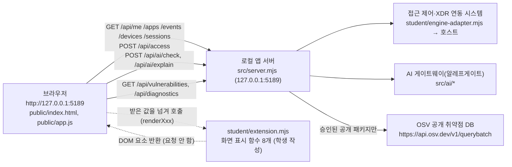

# 케셰브(KESHEV) 학생용 실행 설명서

이 문서는 학생이 작성한 문서입니다. 제공 문서(`README.md`, `docs/GETTING_STARTED_STUDENT.md` 등)는 고치지 않았습니다.
**확인한 것**은 실제로 실행하거나 화면에서 본 것이고, **미확인**은 실행하지 못했거나 근거가 코드를 읽은 것뿐인 것입니다. 추측한 명령이나 연결 성공은 결과처럼 적지 않았습니다.

## 1. 이 프로젝트는 무엇인가

회사 직원이 자기 로그인 상태, 업무 앱 접근 판정, 최근 접속 기록과 보안 경보, AI 연결 상태, AI 사건 설명, 조치 처리 상태, 설치 패키지의 알려진 취약점 조회 결과를 보는 로컬 보안 앱입니다. 서버와 화면 뼈대는 제공된 시작 틀(0.2.14)이고, 학생이 만든 것은 `student/extension.mjs` 한 파일의 화면 표시 함수 8개입니다.

## 2. 지원 환경과 확인한 버전

| 항목 | 값 | 확인 여부 |
|---|---|---|
| Node.js | v24.22.0 (`node -v`) | 확인함. 이 버전으로 서버 시작·화면 조회를 했습니다 |
| 수업 기준 버전 | `package.json`의 `engines.node` 와 제공 문서는 24.19.0 (수업 기준·권장) | 이 PC의 Node 는 24.22.0 이라 24.19.0 에서는 실행해 보지 않았습니다. **미확인** |
| 실행 도구가 허용하는 범위 | `tools/start-alekov.ps1` 은 Node 22~24 에서 실행을 허용하고, 24.19.0 이 아니면 참고 문구만 냅니다 | 코드를 읽어 확인함. 이 범위 안의 다른 버전(22.x, 23.x, 24.19.0 등)에서 실제로 실행해 본 적은 없습니다. **미확인** |
| npm | 11.19.1 (`npm -v`) | 확인함. 외부 npm 의존성은 없어 `npm install`이 필요 없습니다 |
| Git | 2.50.1 | 확인함 |
| 운영체제 | macOS (Darwin 25.6.0), 셸 zsh | 확인함. 아래 3~5장의 명령은 이 환경에서 실행했습니다 |
| Windows PowerShell | 제공 시작 틀의 `tools/start-alekov.ps1` | 이 PC가 Mac 이라 실행하지 못했습니다. **미확인** |
| 브라우저 | Chrome (화면 확인에 사용) | 확인함 |
| 확인하지 않은 환경 | Node 24.22.0 외의 모든 버전(수업 기준 24.19.0 과 도구 허용 범위 22~24 포함), Windows, Chrome 외 브라우저 | 실행해 보지 않았으므로 동작한다고도, 동작하지 않는다고도 적지 않습니다. **미확인** |
| 허용 범위 밖 | Node 22 미만 또는 25 이상 | 실행 도구가 시작을 막는다고 코드에 쓰여 있으나 실행해 보지 않았습니다. **미확인** |

## 3. 폴더 구조와 작업 위치

Git 최상위 폴더는 `keshev-agent/`이고, 앱은 그 안의 `on-client/`입니다. **명령은 `on-client/` 안에서 실행합니다.**

```text
keshev-agent/                      ← Git 최상위 (원격: https://github.com/LeeHakSan/keshev-agent)
└── on-client/                     ← 작업 위치. 모든 npm 명령은 여기서 실행
    ├── package.json               ← 스크립트 start / demo / check (제공)
    ├── .env.example               ← 비밀 없는 설정 견본 (제공)
    ├── README.md, docs/           ← 제공 문서 (수정하지 않음)
    │   └── STUDENT_RUNBOOK.md     ← 이 문서 (학생 작성)
    ├── public/                    ← 브라우저 화면 (제공): index.html, app.js, vulnerabilities-view.mjs
    ├── src/                       ← 로컬 앱 서버 (제공): server.mjs, ai/, actions/, connection/, vulnerabilities/ ...
    ├── student/
    │   ├── extension.mjs          ← 학생이 작성한 화면 표시 함수 (13~20단계)
    │   └── engine-adapter.mjs     ← 접속 판정 시스템 연결 어댑터 (제공, 수정하지 않음)
    ├── tools/                     ← PowerShell 실행 도구 (제공)
    └── vendor/                    ← 제공 라이브러리
```

내 컴퓨터에서의 실제 작업 폴더: `/Users/san/Developer/aleph/aleph-wargame/keshev-agent/on-client`

## 4. 실행·종료·재실행 (macOS 터미널에서 확인한 절차)

1. 터미널(zsh)을 열고 작업 폴더로 이동합니다.

   ```sh
   cd /Users/san/Developer/aleph/aleph-wargame/keshev-agent/on-client
   ```

2. 서버를 켭니다. 둘 중 하나를 씁니다.

   | 명령 | 하는 일 | 정상 시작 신호(터미널 출력) |
   |---|---|---|
   | `npm start` | 실제 연결을 기대하는 기본 실행. 연결이 없으면 화면에 연결 없음이 표시됩니다 | `케셰브 연결 확인: http://127.0.0.1:5189` |
   | `npm run demo` | 예제 자료로 화면을 보여 줍니다. 실제 연결이나 성취가 아닙니다 | `케셰브 예제: http://127.0.0.1:5189` |

3. 브라우저에서 `http://127.0.0.1:5189` 를 엽니다. 화면에 「보호 현황」「업무 앱」「보안 기록」 탭이 보이면 시작된 것입니다. 서버 응답은 `GET /` 가 200 이었습니다.
4. 문법 검사: `npm run check` (`node --check student/extension.mjs`). 오류가 없으면 아무것도 출력하지 않고 끝납니다.
5. 종료: 서버가 켜진 터미널에서 `Ctrl+C`. 종료 뒤 같은 주소가 응답하지 않으면 종료된 것입니다. 이 문서를 쓰는 동안은 프로세스를 직접 종료했고(`pkill -f "node.*src/server"`), 종료 뒤 주소 응답이 없는 것을 확인했습니다. **`Ctrl+C` 자체는 이 문서에서 실행해 확인하지 않았습니다(미확인).**
6. 재실행: 2번을 다시 실행합니다. 서버를 다시 켠 뒤 브라우저를 새로고침하면 화면 상태가 처음(조회 전)으로 돌아갑니다.

제공 문서가 안내하는 Windows 방식(`powershell -NoProfile -ExecutionPolicy Bypass -File .\tools\start-alekov.ps1`)은 **이 PC에서 실행하지 못해 확인하지 않았습니다.**

### 설정과 비밀값

- 설정 견본은 `.env.example` (`ON_PORT=5189`, `ON_ENGINE_ADAPTER=./student/engine-adapter.mjs`, `ON_AI_MODEL=aleph/auto`, `ON_PROJECT_DIRECTORY=`, `ON_APPROVED_PUBLIC_PACKAGES=[]`) 입니다. 비밀값은 없습니다.
- API 키·토큰·비밀번호는 코드, 문서, 커밋에 쓰지 않았습니다. 학생 코드에는 키·토큰·주소를 입력받는 칸이 없습니다.

## 5. 시스템 구성도

### 5-1. 글로 쓴 관계 (Mermaid)



### 5-2. 같은 내용 (ASCII)

```text
브라우저 (public/app.js)
   │  ① 서버에 요청: /api/me /api/apps /api/events /api/devices /api/sessions
   │                  /api/access(POST) /api/ai/check(POST) /api/ai/explain(POST)
   │                  /api/vulnerabilities /api/diagnostics
   ▼
로컬 앱 서버 (src/server.mjs, 127.0.0.1:5189)
   ├─▶ 접근 제어·XDR 연동 시스템  (student/engine-adapter.mjs → 호스트)   ※ 연결 없으면 ENGINE_NOT_CONNECTED
   ├─▶ AI 게이트웨이(알레프게이트) (src/ai/*)                              ※ 권한 준비 전이면 ON_AI_PROVISIONING_PENDING
   └─▶ OSV (src/vulnerabilities/osv.mjs)   승인된 공개 패키지만 조회        ※ 프로젝트 미설정이면 not_configured
   ▲
   │  ② 서버가 돌려준 값을 브라우저가 검사한 뒤
브라우저 ──▶ student/extension.mjs 의 renderXxx(값) ──▶ DOM 요소 ──▶ 화면의 학생 칸에 표시
            (학생 함수는 서버에 요청하지 않고 받은 값만 그림. 단, renderEvents 는 선택 상자와 「<기록 ID> 상세」·「<조치> 미지원」 버튼을,
             renderStatus 는 「도움정보 복사」 버튼과 복사 실패 시 읽기 전용 textarea 를 만듦. 이 버튼들은 화면 안의 표시·복사만 하고 서버 요청을 보내지 않음)
```

### 5-3. 같은 내용 (표)

| 구성 요소 | 실제 파일·주소 | 하는 일 | 학생 작성 여부 |
|---|---|---|---|
| 브라우저 화면 | `public/index.html`, `public/app.js`, `public/vulnerabilities-view.mjs` | 버튼·요청·상태 관리, 서버 응답 검사, 학생 함수 호출 | 제공 (수정하지 않음) |
| 로컬 앱 서버 | `src/server.mjs`, `http://127.0.0.1:5189` | API 제공, 연동 시스템·AI·OSV 중계 | 제공 |
| 접근 제어·XDR 연동 | `student/engine-adapter.mjs`, `src/engine/*` | 로그인·기기·세션·접근 판정·기록 조회 | 제공 (연결은 신뢰된 호스트가 구성) |
| AI 게이트웨이 | `src/ai/*` | 연결 점검, 사건 설명 요청 | 제공 (권한은 운영자가 준비) |
| OSV 조회 | `src/vulnerabilities/*` → `https://api.osv.dev/v1/querybatch` | 승인된 공개 npm 패키지의 정확한 버전 대조 | 제공 |
| 화면 표시 함수 | `student/extension.mjs` | 받은 값을 DOM 으로 표시. 선택 상자·상세 버튼·복사 버튼 같은 화면 안 조작 요소는 만들지만 서버 요청은 보내지 않음 | **학생 작성** |

## 6. 구현한 함수 · 제공 코드 경계 · 확인한 기능

학생이 바꾼 파일은 `student/extension.mjs` 한 개입니다. 제공 서버·`public/app.js`·판정 코드·인증 설정은 수정하지 않았습니다.

| 단계 | 함수 | 보여 주는 것 | 코드 확인 | 모의 데이터 점검 | 실제 화면(예제 서버) |
|---|---|---|---|---|---|
| 13 | `renderIdentity` | 로그인 사용자·기기·세션과 상태 | 함 | 함 | 함 |
| 14 | `renderDecision` | 업무 앱 접근 판정(allow/deny/challenge/unknown)과 이유 | 함 | 함 | 함 (allow/deny/challenge 를 예제 앱에서 확인) |
| 15 | `renderEvents` | 접속 기록·XDR 경보 목록, 걸러 보기, 상세, 미지원 조치 안내 | 함 | 함 | 일부 (예제 기록 1건만 있음) |
| 16 | `renderStatus` | 기기·세션·알림·도움정보와 「도움정보 복사」 | 함 | 함 | 함 (복사 내용 6줄 확인) |
| 17 | `renderAiConnection` | AI 연결 점검 결과와 오류 원인 구분 | 함 | 함 | 권한 준비 중 오류 화면만 확인 |
| 17~18 | `renderExplanation` | 근거·규칙·확인 불가 상태와 함께 AI 사건 설명 | 함 | 함 | 실패 화면만 확인 |
| 19 | `renderAction` | 조치 제안·접수(ACK)·효과 확인·결과 불명 구분 | 함 | 함 | idle 화면만 확인 |
| 20 | `renderVulnerabilities` | 설치 패키지 버전과 OSV 조회 상태 | 함 | 함 | `not_configured` 화면만 확인 |

- 점검 방법: `node --check`, 가짜 DOM 으로 입력을 바꿔 가며 표시를 확인하는 임시 스크립트(저장소에는 넣지 않음), 코드를 일부러 망가뜨려 점검이 잡는지 보는 변형 점검, 실제 브라우저에서 예제 서버 확인.
- 학생 함수의 규칙: `createElement`·`textContent`만 사용, `innerHTML` 계열 없음, 서버 요청(`fetch` 등)·타이머 없음, 호출마다 새 DOM 이라 이전 값이 남지 않음, 비밀값 모양은 `[가림]`으로 가림.
- 학생 코드가 만드는 조작 요소(모두 서버 요청을 보내지 않음, 실제 코드 위치로 확인함):

  | 함수 | 만드는 요소 | 하는 일 |
  |---|---|---|
  | `renderEvents` | 선택 상자 3개(기록 종류·업무 앱·접속 상태, 각각 label 포함) | 화면 안에서 기록 목록을 걸러 보기 |
  | `renderEvents` | 기록마다 「<기록 ID> 상세」 버튼 | 그 기록의 근거·규칙·상태 상세를 펼침·접음 |
  | `renderEvents` | 기록에 지원 조치가 있을 때 비활성 「<조치> 미지원」 버튼 | 조치를 실행하지 않음. 눌러도 아무 일도 없고 연결 준비 중이라는 안내만 있음 |
  | `renderStatus` | 「도움정보 복사」 버튼 | 누를 때만 도움정보 6줄을 클립보드에 복사 |
  | `renderStatus` | 복사 실패 시 읽기 전용 textarea | 직접 복사할 값을 보여 줌 |
  | 그 밖의 함수 | 없음 | `renderIdentity`·`renderDecision`·`renderAiConnection`·`renderExplanation`·`renderAction`·`renderVulnerabilities` 는 표시만 하고 버튼·입력 칸을 만들지 않음 |

  서버로 가는 요청(조회·점검·설명 요청·집행·재조회·취소)은 모두 제공 `public/app.js` 의 버튼이 보냅니다.
- 제공 코드와 학생 코드의 경계: 요청·취소·늦은 응답 차단·확인 번호 보관·응답 검증은 제공 `public/app.js` 가 합니다. 학생 함수는 넘어온 값을 표시만 합니다.

### 화면의 버튼 이름 (실제 `public/index.html`·`public/app.js`·`student/extension.mjs` 와 대조함)

「다시 불러오기」「보호 현황」「업무 앱」「보안 기록」「도움정보 불러오기」「도움정보 복사」(학생 칸)「AI 연결 점검」「AI 설명 요청」「설치 패키지 조회」「대상과 조치를 확인했으며 집행합니다」「원천 결과만 재조회」「조치 화면 취소」. 학생 코드 안에 따옴표(「」)로 적힌 버튼 이름은 이 목록과 일치하는지 대조했습니다.

## 7. 오류별 확인 순서

| 화면·응답에 보이는 것 | 의미 | 확인 순서 | 이 PC에서 본 적 있는가 |
|---|---|---|---|
| `ENGINE_NOT_CONNECTED` ("기존 서버·에이전트의 연결을 확인할 수 없습니다") | 접근 제어·XDR 연동이 연결되지 않음 (`npm start` 기본 상태) | ① 서버 터미널의 시작 문구 확인 ② 담당자 안내에 따른 연결 구성 확인 ③ `docs/CONNECTION_TROUBLESHOOT.md` | 봄 (`GET /api/me` 응답) |
| 화면의 "연결 실패" / "연결 없음(disconnected)" | 서버가 꺼졌거나 연결 없음 | ① 서버가 켜져 있는지 ② `http://127.0.0.1:5189` 응답 ③ 서버 재실행 후 「다시 불러오기」 | 봄 (서버를 끄고 확인) |
| `CONTRACT_MISMATCH`, `ENGINE_RESULT_UNVERIFIED` | 응답 형식·내용을 확인할 수 없음 → 확인 불가 | 성공으로 보지 않고 직접 다시 조회 | 모의 데이터로만 확인 |
| `TIMEOUT`, `REQUEST_TIMEOUT`, `ENGINE_TIMEOUT`, `WB_CLCO_TIMEOUT` | 시간 초과 | 잠시 뒤 제공 화면의 버튼을 직접 눌러 다시 시도 (자동 재시도 없음) | 모의 데이터로만 확인 |
| `ON_AI_PROVISIONING_PENDING` | AI 이용 권한 준비 중 (학생 잘못이 아님) | 담당자에게 계정 연결과 앱 권한 확인 요청 | 봄 (예제 서버에서 AI 점검·설명) |
| `WB_CLCO_AUTH_REQUIRED`, `WB_CLCO_ACCESS_BLOCKED` | 인증 실패·접근 제한 | 계정 연결을 다시 확인, 담당자 확인 | 모의 데이터로만 확인 |
| `WB_CLCO_COHORT_BUDGET_EXHAUSTED`, `WB_CLCO_LIMIT_REACHED`, `WB_CLCO_SESSION_CLOSED` | 반 사용량·이용 한도·이용 시간 아님 | 담당자·이용 시간 확인 | 모의 데이터로만 확인 |
| `WB_CLCO_RATE_LIMITED`, `NETWORK_ERROR`, `WB_CLCO_NETWORK_ERROR`, `WB_CLCO_SERVER_UNAVAILABLE` | 요청 제한·네트워크 | 잠시 뒤 직접 다시 점검 | 모의 데이터로만 확인 |
| `ON_AI_MODEL_LIST_EMPTY` | 쓸 수 있는 AI 모델 없음 | 담당자에게 모델 허용 설정 확인 요청 | 모의 데이터로만 확인 |
| `PROJECT_NOT_CONFIGURED` (`not_configured`) | OSV 조회 대상 프로젝트 설정 없음 | 운영자가 준비하는 설정. 학생이 임의로 바꾸지 않음 | 봄 (예제 서버) |
| `CANCELLED` | 사용자가 취소 | 이전 결과는 현재 결과가 아님 → 직접 다시 조회 | 봄 (패키지 조회 취소) |
| `ACTION_*` (확인 기한 만료, 범위 변경, 결과 불명 등) | 조치 처리 상태 | 「원천 결과만 재조회」로 결과만 조회, 필요하면 조치를 다시 준비 | 모의 데이터로만 확인 |

공통 원칙: 조회 실패·미조회·확인 불가는 "안전함·효과 없음·취약점 없음"으로 읽지 않습니다. 재시도는 사용자가 제공 화면의 버튼을 직접 누를 때만 일어납니다(학생 코드는 요청을 보내지 않음).

## 8. 미확인 기능 (확인했다고 적지 않음)

- 실제 접근 제어·XDR 연동(`connected`) 상태의 판정·기록·기기·세션 화면. 이 PC 에서는 연동 시스템에 연결하지 못했습니다.
- AI 연결 점검 성공(`test`/`verified`)과 실제 AI 사건 설명 성공 화면. 운영 측 계정·앱 권한이 준비되어야 합니다.
- 조치 준비·집행·접수(ACK)·효과 확인 경로. 예제 기록에 지원 조치가 없어 열리지 않으며, 실제 집행은 시험 삼아 요청하지 않았습니다.
- OSV 조회 표(`complete`/`partial`/`not_checked`/`unverifiable`). 프로젝트에 `package-lock.json` 과 승인된 공개 패키지가 없어 실제 표는 보지 못했습니다.
- Windows PowerShell 실행 절차, Node 24.19.0(수업 기준)과 Node 22~24 허용 범위의 다른 버전에서의 실행, `Ctrl+C` 종료.
- 1280px 이상 넓은 화면 배치 (확인한 브라우저 창 너비가 약 855px).
- 서버의 AI 가 이 문서와 코드를 읽고 내리는 판정 결과.

## 9. 작업 기록과 제출

- 단계별로 커밋했고(`git log --oneline`), 모두 `student/extension.mjs` 한 파일의 변경이었습니다. 21단계에서는 이 문서를 추가했고, 심사 피드백에 따라 조작 요소 설명과 Node 버전 표를 고쳤고, 19단계 안내 문구의 버튼 이름 하나(「원천 결과만 재조회」)를 실제 화면 글자에 맞게 고쳤습니다.
- 제출 값: 저장소 `https://github.com/LeeHakSan/keshev-agent`(공개), 해당 단계의 40자리 커밋. 공개 저장소이므로 비공개 원문 묶음(JSON)은 사용하지 않습니다.
